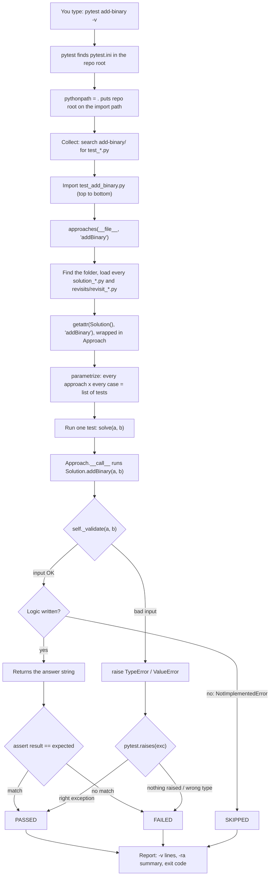

# Testing workflow: what happens when you run `pytest <folder> -v`

This file follows one command from start to finish and names the file or line responsible for each step.

Example used throughout: **`pytest add-binary -v`** (folder `add-binary`, method `addBinary`).
For any other problem, swap in its folder name and LeetCode method name.

---

## 1. The pieces

| Piece | Where | Its one job |
|---|---|---|
| `pytest.ini` | repo root | The rulebook: which files are tests, where `helpers.py` is, how to import |
| `helpers.py` | repo root | The finder: collects every solution of one problem into a list |
| `test_<problem>.py` | each problem folder | The checks: test cases and `assert`s |
| `solution_N_<approach>.py` | each problem folder | The code under test: `class Solution` with the LeetCode method |
| `_validate()` | inside each solution | The guard: rejects bad input before the real work starts |
| `.github/workflows/tests.yml` | repo | The automation: runs `pytest` on GitHub on every push |

---

## 2. Who points to what (quick answers)

| Question | Answered by |
|---|---|
| Which **folder** does pytest search? | The folder you type: `pytest add-binary`. With plain `pytest`, `testpaths = .` in `pytest.ini` means the whole repo |
| Which **files** are test files? | `python_files = test_*.py` in `pytest.ini` |
| Which **functions** are tests? | pytest's default rule: functions whose names start with `test_` |
| How can a test file **import `helpers`** from a subfolder? | `pythonpath = .` in `pytest.ini` (puts the repo root on Python's import path) |
| Why don't folders need `__init__.py`, and why don't test files clash? | `--import-mode=importlib` in `addopts` |
| Which **folder holds the solutions**? | `__file__` → `Path(test_file).resolve().parent` in `approaches()` |
| Which **files are solutions**? | `glob("solution_*.py")` and `glob("revisits/revisit_*.py")` in `approaches()` |
| Which **class**? | Hard-coded in `helpers.py`: `.Solution()` |
| Which **method**? | The string you pass: `approaches(__file__, "addBinary")` → `getattr(Solution(), "addBinary")` |
| Which **revisit methods**? | Names equal to `addBinary` or starting with `addBinary_` |
| Why is `_validate` **not tested as a solution**? | Its name doesn't match `addBinary` / `addBinary_*`, so `approaches()` ignores it |
| How does one test run **every approach**? | `@pytest.mark.parametrize("solve", APPROACHES, ids=repr)` |
| Where do the **test names** come from? | `id="..."` in each `pytest.param` + `ids=repr` → `Approach.__repr__` (the file name) |
| Why are unsolved starters **skipped**, not failed? | `Approach.__call__` catches `NotImplementedError` and calls `pytest.skip` |
| Who **checks the input**? | `self._validate(a, b)`, the first line of `addBinary` |
| Who decides **pass / fail**? | `assert ... == expected` or `with pytest.raises(...)` in the test function |
| Who prints **one line per test**? | `-v` (you type it) |
| Who prints the **skip/fail summary**? | `-ra` (added automatically by `addopts`) |
| Who runs the tests **on GitHub**? | `.github/workflows/tests.yml` |

---

## 3. Process flow (diagram)



---

## 4. Step by step

### Step 1: You start the run
```bash
source .venv/bin/activate     # use the project's Python, where pytest is installed
pytest add-binary -v
```
- `add-binary` → **points pytest to the folder**. Only this folder is searched.
- `-v` → verbose: one line per test instead of one dot.

### Step 2: pytest finds its rulebook (`pytest.ini`)
- pytest looks for `pytest.ini` in `add-binary/`, then in each parent folder. It finds it at the repo root.
- That folder becomes the **rootdir**. The run prints `rootdir: .../Python_Daily` and `configfile: pytest.ini`.
- Settings it reads:

| Setting | What it does |
|---|---|
| `pythonpath = .` | Adds the repo root to `sys.path`, so `from helpers import approaches` works from any folder |
| `testpaths = .` | Used only when you run plain `pytest` with no folder: "search the whole repo" |
| `python_files = test_*.py` | Only files matching this are test files (so `solution_*.py` and `helpers.py` are never collected as tests) |
| `addopts = -ra --import-mode=importlib` | Added to every run as if you typed them |
| `norecursedirs = .git .github .venv venv __pycache__` | Folders pytest never searches |

### Step 3: Collection finds the test file
- pytest walks `add-binary/` (skipping `__pycache__`) and keeps files matching `test_*.py`.
- Result: `add-binary/test_add_binary.py`.

### Step 4: pytest imports the test file (its top-level code runs now)
The file runs top to bottom, once.

**4a.** `import pytest`

**4b.** `from helpers import approaches`. This works because of `pythonpath = .` (Step 2).

**4c.** `APPROACHES = approaches(__file__, "addBinary")`. Inside `helpers.py`:

| # | Line in `approaches()` | What it does |
|---|---|---|
| 1 | `__file__` | Full path of the test file, e.g. `.../Python_Daily/add-binary/test_add_binary.py` |
| 2 | `Path(test_file).resolve().parent` | **Points to the solution folder**: `.../add-binary/` |
| 3 | `sorted(folder.glob("solution_*.py"))` | **Points to the solution files**, in a fixed order: `solution_1_built_in_conversion.py`, `solution_2_carry.py` |
| 4 | `re.sub(r"^solution_\d+_", "", path.stem)` | Gets the approach name (`style`): `built_in_conversion`, `carry` |
| 5 | `_load(path)` | Imports the file by its path (`add-binary` has a hyphen, so a normal `import` is impossible). This defines `class Solution` but **calls nothing yet** |
| 6 | `.Solution()` | **Points to the class**: creates a `Solution` object |
| 7 | `getattr(obj, method)` | **Points to the method**: gets `addBinary` from that object, using the string you passed |
| 8 | `Approach(name, style, func)` | Wraps the method with a readable name (`solution_1_built_in_conversion`) |
| 9 | `glob("revisits/revisit_*.py")` + `dir(solver)` | Same for revisits: keeps methods named `addBinary` or `addBinary_<style>`. `_validate` doesn't match, so it is never treated as a solution |
| 10 | `if not found: raise FileNotFoundError` | No solutions found → stop with an error instead of silently testing nothing |
| 11 | `return found` | `APPROACHES = [solution_1_built_in_conversion, solution_2_carry]` |

**4d.** `CASES = [...]` and `BAD_INPUTS = [...]` are built. They are just data: `pytest.param(a, b, expected, id="...")`.

**4e.** The `test_...` functions are defined. Their `@pytest.mark.parametrize` decorators attach the lists from 4c and 4d.

### Step 5: pytest builds the list of tests
- pytest finds every function named `test_*`.
- Stacked `parametrize` decorators **multiply**: every approach × every case.
  - Example: 9 `CASES` × 2 approaches = 18 tests from `test_cases` alone.
- Each test gets a name: `test_cases[<case id>-<approach name>]`
  - `<case id>` comes from `id="..."` in `pytest.param`.
  - `<approach name>` comes from `ids=repr` → `Approach.__repr__` → `self.name`.
- The run prints `collected N items`.

### Step 6: pytest runs each test (example: `test_cases[leetcode-example-1-solution_1_built_in_conversion]`)

| # | What runs | What happens |
|---|---|---|
| 6a | pytest | Calls `test_cases(solve=<Approach solution_1_built_in_conversion>, a="11", b="1", expected="100")` |
| 6b | `solve(a, b)` | `solve` is an `Approach` object. It can be called like a function because it defines `__call__` |
| 6c | `Approach.__call__` | Runs `self._func("11", "1")`, which is `Solution().addBinary("11", "1")` |
| 6d | `addBinary`, line 1 | `self._validate(a, b)` checks the inputs (see Section 5). OK → returns `None` |
| 6e | `addBinary`, the logic | `bin(int("11", 2) + int("1", 2))` → `"0b100"` → `.removeprefix("0b")` → `"100"` |
| 6f | back in the test | `"100"` is returned to `test_cases` |

### Step 7: pass, fail or skip is decided

| Situation | Who decides | Result |
|---|---|---|
| `assert result == expected` is true | `assert` | **PASSED** |
| `assert` is false | `assert` (pytest shows both values, e.g. `assert '10' == '11'`) | **FAILED** |
| Bad-input test, the right exception is raised | `with pytest.raises(exc)` catches it | **PASSED** |
| Bad-input test, nothing is raised | `pytest.raises` | **FAILED**: `Failed: DID NOT RAISE ValueError` |
| Bad-input test, a different exception type | the error passes through `pytest.raises` | **FAILED** |
| Logic not written (`raise NotImplementedError`) | `Approach.__call__` catches it → `pytest.skip(...)` | **SKIPPED** |
| Any other unexpected error | pytest | **FAILED** |

### Step 8: the report
A real run (two cases, before Approach 2 was solved):
```text
rootdir: .../Python_Daily
configfile: pytest.ini
collecting ... collected 4 items

add-binary/test_add_binary.py::test_cases[leetcode-example-1-solution_1_built_in_conversion] PASSED [ 25%]
add-binary/test_add_binary.py::test_cases[leetcode-example-1-solution_2_carry] SKIPPED [ 50%]
add-binary/test_add_binary.py::test_bad_inputs[digit-2-solution_1_built_in_conversion] PASSED [ 75%]
add-binary/test_add_binary.py::test_bad_inputs[digit-2-solution_2_carry] PASSED [100%]

=========================== short test summary info ============================
SKIPPED [1] helpers.py:37: solution_2_carry is not written yet
========================= 3 passed, 1 skipped in 0.02s =========================
```
- One line per test → from `-v`.
- "short test summary info" → from `-ra` (in `addopts`).
- **Exit code** (what CI looks at):

| Code | Meaning |
|---|---|
| 0 | Everything passed (skips are OK) |
| 1 | At least one test failed |
| 2 | Error before running, e.g. while importing a test file |
| 5 | No tests collected, e.g. a test file with no `test_` functions yet |

### Step 9: the same thing on GitHub (CI)
When you push, `.github/workflows/tests.yml` runs:
1. `actions/checkout`: a fresh copy of the repo on a clean Ubuntu machine.
2. `actions/setup-python`: Python 3.12.
3. `pip install pytest`
4. `pytest`, with no folder, so `testpaths = .` → **every problem**.

Exit code 0 → green check on the commit. Anything else → red X (see the Actions tab).

---

## 5. `_validate()` in detail

**Where it lives:** inside each `solution_*.py`, below the main method:
```python
@staticmethod
def _validate(a: str, b: str) -> None:
    for name, value in (("a", a), ("b", b)):
        if not isinstance(value, str):
            raise TypeError(f"{name} must be a str, got {type(value).__name__}")
        if not value:
            raise ValueError(f"{name} must not be empty")
        if not all(ch in "01" for ch in value):
            raise ValueError(f"{name} may only contain 0 and 1, got {value!r}")
```

**Who calls it:** only `addBinary` itself, on its first line: `self._validate(a, b)`.
pytest and `helpers.py` never call it directly. It runs because the method under test calls it.

**What it does, in order, for `a` and then for `b`:**

| Check | Fails when | Raises |
|---|---|---|
| 1. `isinstance(value, str)` | Not a string: `11`, `None` | `TypeError` |
| 2. `if not value` | Empty string `""` | `ValueError` |
| 3. `all(ch in "01" for ch in value)` | Any other character: `"12"`, `"1a"`, `" 1"`, `"1_0"`, `"0b1"` | `ValueError` |
| All passed | (nothing) | Returns `None`; `addBinary` continues |

- **Why this order:** the type is checked first, so checks 2 and 3 can safely treat the value as a string.
- **Why `@staticmethod`:** it doesn't need `self`. `self._validate(...)` is just a convenient way to reach it.
- **Why the `_`:** by convention it means "internal helper, not part of the public API". It is also why `approaches()` never picks it up.
- **Which tests depend on it:** `test_bad_inputs`, through `pytest.raises(...)`.

**Two traps (both confirmed with real runs):**
1. **Starters pass bad-input tests.** In an unsolved starter, `_validate` runs *before* `raise NotImplementedError`. So `test_bad_inputs` **passes** for `solution_2_carry` while `test_cases` is **skipped**. A green bad-input test does not mean the logic works.
2. **Some bad inputs fail even without `_validate`.** With `_validate` removed from Approach 1, the `"12"` test still passed, because `int("12", 2)` raises `ValueError` on its own. Only `" 1"`, `"1_0"` and `"0b1"`, which `int(x, 2)` quietly accepts, caught the missing validation (`DID NOT RAISE ValueError`). That is why those cases are in the test plan.

---

## 6. What can go wrong, and where you see it

| Mistake | Breaks at | What you see |
|---|---|---|
| Test file not named `test_*.py` | Step 3 | File ignored; `collected 0 items` |
| Test function not named `test_*` | Step 5 | That function never runs |
| Typo in the method name: `approaches(__file__, "addbinary")` | Step 4c | `ERROR collecting ... AttributeError: 'Solution' object has no attribute 'addbinary'. Did you mean: 'addBinary'?`, exit code 2 |
| Class not named `Solution` | Step 4c | `AttributeError: module ... has no attribute 'Solution'` |
| Solution file not named `solution_*.py` | Step 4c | That solution is silently **not tested** |
| No solution files at all | Step 4c | `FileNotFoundError: no solution_*.py files next to ...` |
| Wrong expected value, or a bug in the logic | Step 7 | `FAILED` with `assert '10' == '11'` |
| Validation missing or too loose | Step 7 | `FAILED`: `DID NOT RAISE ValueError` |
| Test file has no tests yet | Step 8 | `no tests ran`, exit code 5 |

---

## 7. Useful commands

```bash
source .venv/bin/activate
pytest add-binary -v                                   # one problem, one line per test
pytest add-binary -v -k solution_1                     # only tests whose name contains "solution_1"
pytest add-binary -v -k "leetcode"                     # only the LeetCode example cases
pytest add-binary/test_add_binary.py::test_bad_inputs -v   # one test function
pytest add-binary -x                                   # stop at the first failure
pytest add-binary --collect-only -q                    # list the tests without running them
pytest                                                 # every problem (what CI runs)
```

---

## 8. Is this how production does it?

**The same in production:**
- Tests live next to the code.
- One config file (`pytest.ini` or `pyproject.toml`) sets the rules.
- Each test checks a contract (inputs → expected output or exception).
- CI runs every test on every push and pull request.

**Specific to this practice repo:**
`helpers.py` auto-discovers several solutions to one problem. Production code usually has one implementation per function, imported directly in the test.

**What a production repo usually adds:**
- Pinned dependencies (`requirements.txt` / `pyproject.toml`).
- Branch protection: no merge until CI is green.
- Several Python versions in CI.
- Linting and type checks (ruff, mypy).
- Coverage reports.
- Pre-commit hooks.
